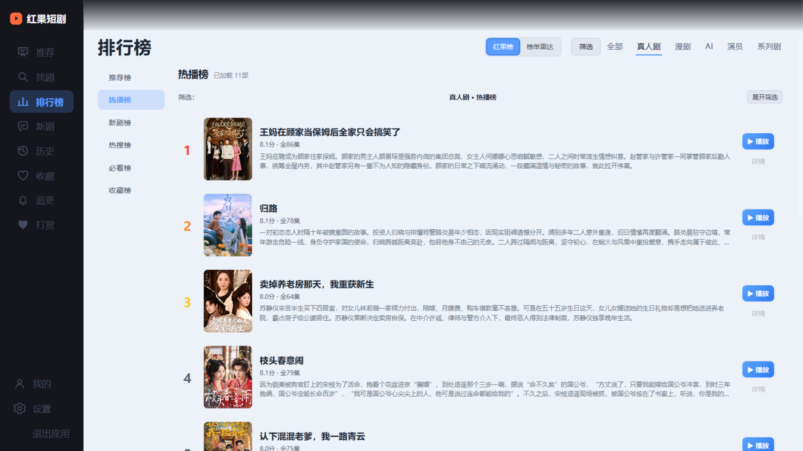
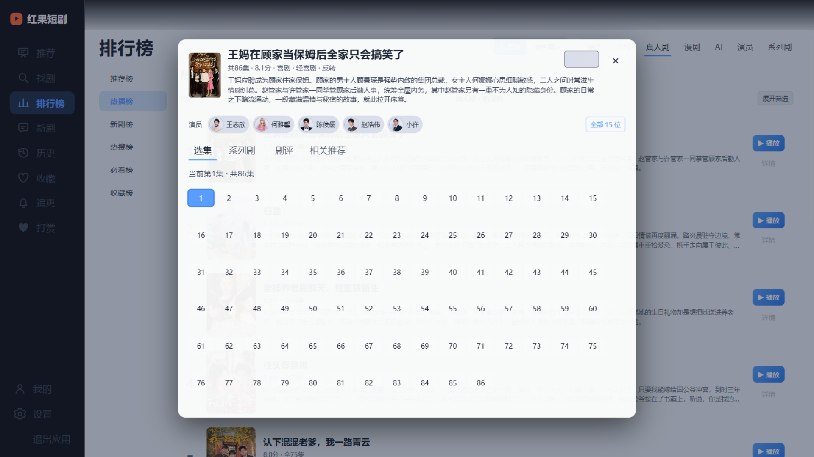
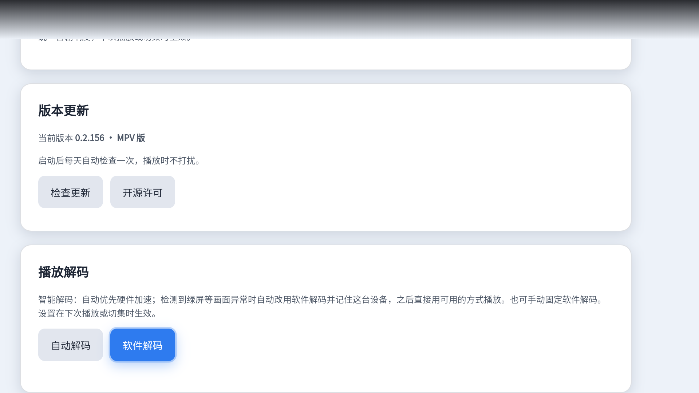
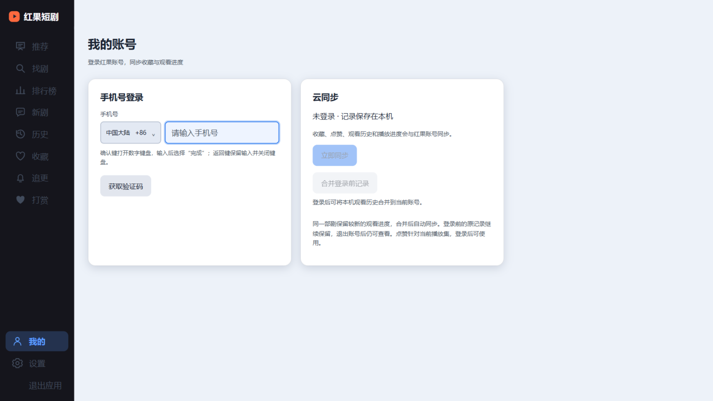

# 红果极速（TV 版）

专为电视与电视盒子打磨的红果短剧生态第三方极速客户端。大屏、遥控器优先、
极速换剧换集，带完整的自更新通道与自动发版流水线。

> 基于 [aston314/hongguo-tv](https://github.com/aston314/hongguo-tv) 二次开发的独立发行版，
> 包名、签名、更新通道均已独立，与上游互不影响。感谢原作者的出色工作。

## 界面一览

| 沉浸播放（全屏连播） | 悬浮控制 Dock |
| --- | --- |
|  |  |

| 更多功能网格 | 排行榜 |
| --- | --- |
|  |  |

| 找剧 | 剧集详情与选集 |
| --- | --- |
|  |  |

| 观看历史 | 设置与播放解码 |
| --- | --- |
|  |  |

| 我的账号与云同步 | 首次启动指南 |
| --- | --- |
|  |  |

## 特性

### 播放体验

- **全屏连播**：进入即播，一集看完自动接下一集，一部看完自动接下一部（所有入口统一：历史、搜索、排行、详情页看完同样连播）
- **无缝换集**：下一集在播放中静默预取落盘，mpv / Media3 原生播放内核以播放列表接力，EOF 直接续播下一集；预取未就绪时回退官方风格过渡卡
- **官方式过渡卡**：预取未就绪的换集/换剧封面卡片滑入，画面就绪即揭开；封面自带兜底，不再出现黑卡
- **竖屏剧自动跳过**：内置随版本更新的横屏参数库（自动爬取、按 series_id 去重、运行时增量刷新），已知横屏剧零探测秒开，竖屏剧静默跳过；未知剧用 64KB 头部探测，10 秒内不阻塞起播
- **起播永不卡死**：播放准备全程有超时兜底（探测竞速、看门狗、自动刷新一次、失败面板），不再出现"转圈到天荒地老"
- **音量均衡**：动态响度归一，各剧之间不再忽大忽小
- **硬解优先，崩溃自愈**：自动硬解；解码服务异常时自动降级软解，下次启动自愈

### 遥控器交互

- **统一按键语法**：↑↓ 换剧，←→ 切集，OK/菜单键呼出控制中心，返回逐级退出、双击退出应用
- **悬浮控制 Dock**：进度条 + 五大按键（历史/选集/播放/倍速/更多），白色播放键为视觉锚点
- **极速响应**：焦点路由零布局重排，按键即达；控制条出现时焦点必定落在控制条上（含自动隐藏后的死焦点自愈）
- **首次启动指南**：只显示一次，四行大字讲清全部按键

### 功能页面

- 找剧/排行榜/新剧/收藏/追更/我的/打赏/设置，全部接入统一交互
- 弹幕、清晰度切换、选季、倍速、诊断面板
- 退出时记住剧目与进度，下次进入从原处继续
- 登录官方账号后历史云同步，重装不丢
- **真随机发现流**：首页推荐不再跟随官方个性化排序，由本地从全库分类接口洗牌构建，且自动排除观看历史里看过的剧（`shuffle=0` 可切回官方流）

### 更新机制

- 应用内自动检查（每小时），发现新版本静默后台下载、断点续传；就绪后前台自动弹窗"一键安装"（播放中不打扰，回到首页即补弹）
- 界面启动异常时自动转入"更新恢复"模式：原生弹窗提示新版本，不依赖页面本身
- 推送 `v*` 标签即自动构建发布（GitHub Actions），产出签名 APK 与更新清单

### 横屏参数库（免维护）

- 仓库内 `core/cmd/hongguotv/data/series-orientation.json` 记录每部剧的宽高与横竖屏判定，按 series_id 天然去重
- 定时工作流 `orientation-crawler`（每日）自动枚举公开分类接口、用 Range 头部探测新剧并提交更新，无需人工维护
- 应用构建时内嵌最新快照；运行中每 6 小时从发布渠道镜像增量刷新；本机学到的判定也会持久化

## 安装

1. 在 [Releases](https://github.com/jingrongx/hongguo-tv-speed/releases) 下载 `hongguo-tv-speed-mpv-<版本>.apk`
   （MPV 播放内核版，推荐）或 `hongguo-tv-speed-<版本>.apk`（标准 WebView 版）
2. 通过 U 盘或 `adb install` 安装到电视
3. 应用启动后自动检查更新（每小时一次）；也可在"设置 → 应用更新"手动检查

## 构建

依赖：Go 1.25+、JDK 17、Android SDK/NDK（r27）、Gradle 8.x、Node.js 22（测试）。

```bash
# 1. 编译 Go 核心（三个 ABI；改 core/cmd/hongguotv/ui/ 下任何文件都必须重编）
#    版本号必须与 android/app/build.gradle 的 appVersion 一致，格式 <版本>-dev
GOOS=android GOARCH=arm64 CGO_ENABLED=1   CC=$NDK/toolchains/llvm/prebuilt/windows-x86_64/bin/aarch64-linux-android23-clang.cmd   go build -trimpath -ldflags "-s -w -X main.version=0.2.153-dev"   -o ../android/app/src/main/jniLibs/arm64-v8a/libhongguotv.so ./cmd/hongguotv

# 2. 构建 APK（签名读取 android/keystore.properties，或 CI 环境变量）
cd android && gradle assembleMpvRelease

# 3. 前端回归测试（508 项）
node --test tests/*.cjs
```

### 自动发版

推送 `v*` 标签即可：

```bash
git tag v0.2.153 && git push origin v0.2.153
```

CI 自动：编译三 ABI 核心 → 拉取 mpv-android 库并编译桥接 → 签名 APK →
发布 Release（含 SHA256SUMS）→ 提交更新清单到 main。签名密钥通过仓库
Secrets（`ANDROID_KEYSTORE_*`）注入，本地签名密钥不进仓库。

## 项目结构

```
core/                 Go 核心：本地 HTTP API + go:embed 内嵌 TV UI
  cmd/hongguotv/      入口与内嵌资源（ui/、locales/）
android/              Android 壳：WebView + 原生播放桥
  app/src/mpv/        MPV 播放内核（libmpv + JNI 桥接）
  app/src/main/       通用壳（服务、更新器、电视频道集成）
tests/                Node 前端回归测试（508 项）
docs/screenshots/     界面截图
```

## 致谢

- [aston314/hongguo-tv](https://github.com/aston314/hongguo-tv) — 原项目
- [mpv-android](https://github.com/mpv-android/mpv-android) — libmpv 播放内核
- 所有反馈问题的电视盒用户

## 许可

与上游项目保持一致。
