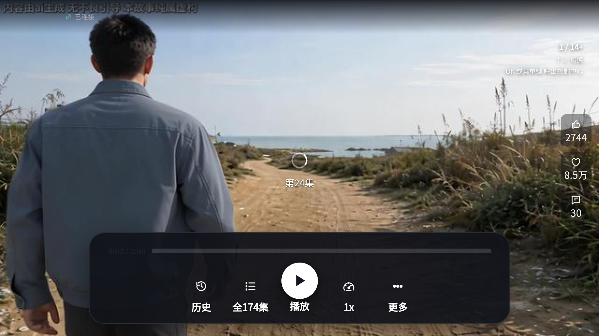
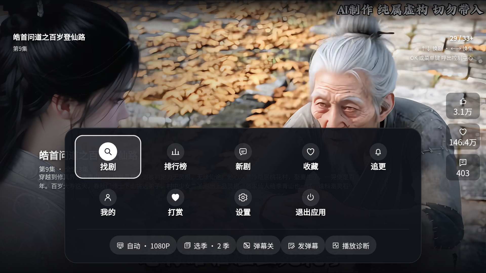
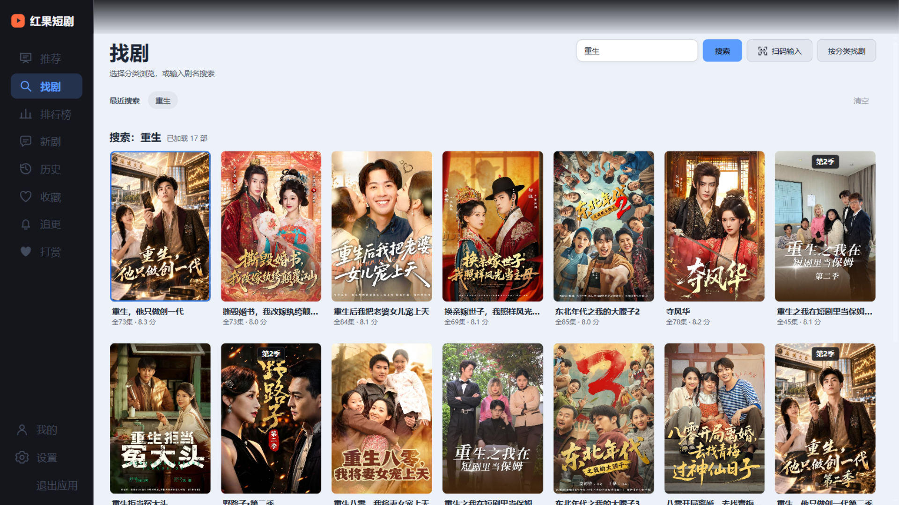
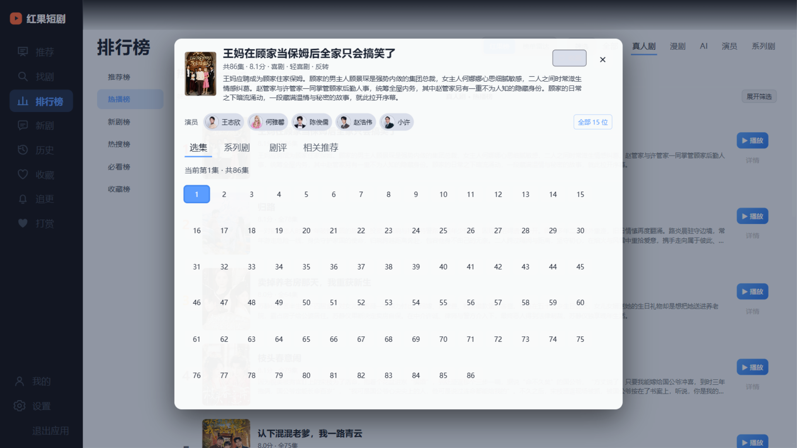
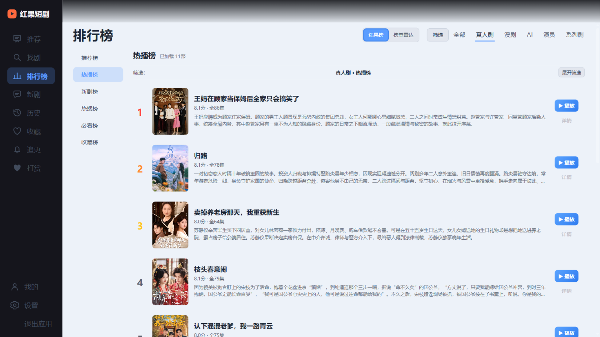
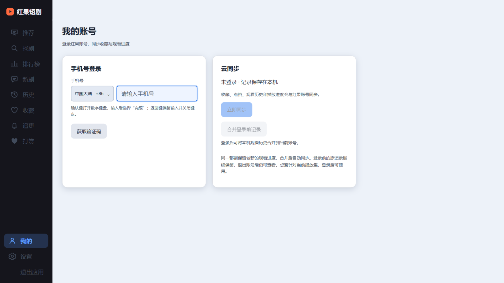
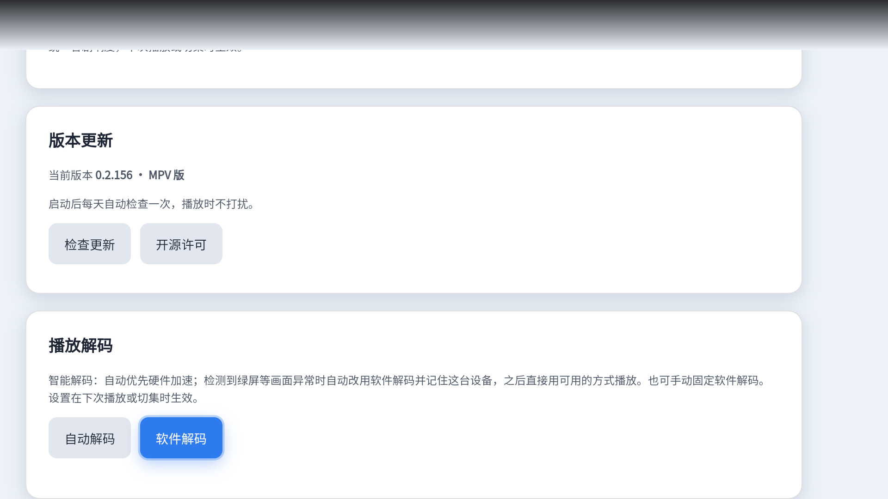
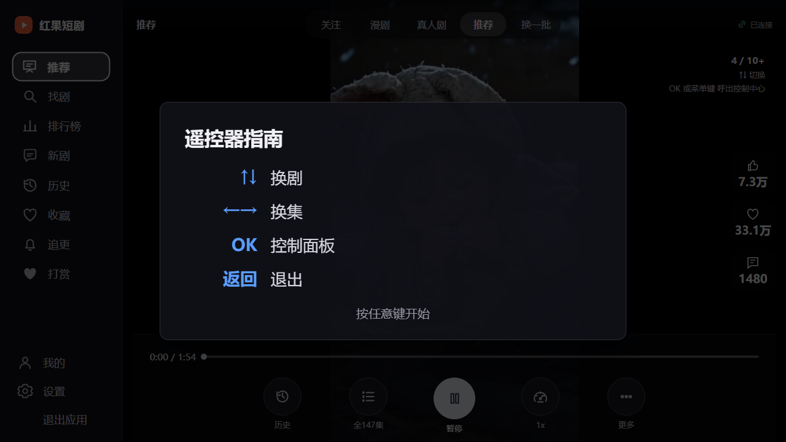

<div align="center">

# 🍉 红果极速

**为电视、手机与车机打磨的红果短剧第三方极速客户端**

大屏遥控优先 · 手机触屏原生 · 极速换剧换集 · 自动更新免维护

[](https://github.com/jingrongx/hongguo-tv-speed/releases/latest)
[](#-下载)
[](#-下载)
[](#%EF%B8%8F-%E6%9B%B4%E6%96%B0%E6%9C%BA%E5%88%B6)
[](#)

**[⬇️ 下载最新版](https://github.com/jingrongx/hongguo-tv-speed/releases/latest)** ·
[📋 全部版本](https://github.com/jingrongx/hongguo-tv-speed/releases) ·
[🐛 问题反馈](https://github.com/jingrongx/hongguo-tv-speed/issues)



</div>

---

## ✨ 一眼看点

| | |
| --- | --- |
| 🎬 **全屏连播** | 进入即播，看完自动接下一集、下一部，所有入口统一连播 |
| ⚡ **无缝换集** | 下一集播放中静默预取落盘，接力续播，无黑屏无转圈 |
| 📱 **全端适配** | 电视遥控、手机触屏、车机竖屏——一套安装包三种用法 |
| 🧭 **真随机发现流** | 本地洗牌全库推荐，自动排除看过的剧，刷不完的新剧 |
| 🛡 **起播永不卡死** | 探测竞速 + 看门狗 + 自动恢复，告别"转圈到天荒地老" |
| 🔊 **音量均衡** | 动态响度归一，换剧不再忽大忽小 |
| 🗂 **竖屏剧自动跳过** | 横屏参数库每日自动爬取更新，已知横屏剧零探测秒开 |
| 🔄 **自动更新** | 每小时检查，静默下载断点续传，一键安装不打扰观看 |

## 📥 下载

| 安装包 | 适用设备 | 播放内核 |
| --- | --- | --- |
| 📺 `hongguo-tv-speed-mpv-<版本>.apk` **（推荐）** | 电视 / 盒子 | MPV 硬解 |
| 📱 `hongguo-phone-speed-mpv-<版本>.apk` | 手机 / 车机 | MPV 硬解 |
| 🌐 `hongguo-tv-speed-<版本>.apk` | 电视（轻量设备） | WebView |

> 💡 电视 MPV 版与手机 MPV 版是**同一安装包**，界面自动适配设备与方向，
> 按下载设备习惯任选其一即可。要求 Android 5.0 及以上。

**安装步骤**：下载 APK → U 盘拷贝或 `adb install` 安装 → 启动后自动检查更新
（每小时一次），也可在 **设置 → 应用更新** 手动检查。

## 🖼 界面一览

| 悬浮控制 Dock | 更多功能网格 |
| --- | --- |
|  |  |

| 找剧 | 剧集详情与选集 |
| --- | --- |
|  |  |

<details>
<summary><b>展开更多界面</b></summary>

| 排行榜 | 观看历史 |
| --- | --- |
|  |  |

| 我的账号与云同步 | 设置与播放解码 |
| --- | --- |
|  |  |

| 首次启动指南 | — |
| --- | --- |
|  | |

</details>

## 🚀 更新机制

- 应用内自动检查（每小时），发现新版本**静默后台下载、断点续传**；就绪后自动弹窗"一键安装"（播放中不打扰，回到首页即补弹）
- 界面启动异常时自动转入"更新恢复"模式：原生弹窗提示新版本，不依赖页面本身
- 每次提交自动构建发版（GitHub Actions）：编译三 ABI 核心 → 拉取 mpv-android 库并编译桥接 → 签名 APK → 发布 Release（含 SHA256SUMS）→ 回写更新清单

## 🗂 横屏参数库（免维护）

- 仓库内 `core/cmd/hongguotv/data/series-orientation.json` 记录每部剧的宽高与横竖屏判定，按 series_id 天然去重
- 定时工作流 `orientation-crawler`（每日）自动枚举公开分类接口、用 Range 头部探测新剧并提交更新，无需人工维护
- 应用构建时内嵌最新快照；运行中每 6 小时从发布渠道镜像增量刷新；本机学到的判定也会持久化

## 🛠 构建

<details>
<summary><b>展开构建说明</b></summary>

依赖：Go 1.25+、JDK 17、Android SDK/NDK（r27）、Gradle 8.x、Node.js 22（测试）。

```bash
# 1. 编译 Go 核心（三个 ABI；改 core/cmd/hongguotv/ui/ 下任何文件都必须重编）
#    版本号必须与 android/app/build.gradle 的 appVersion 一致，格式 <版本>-dev
GOOS=android GOARCH=arm64 CGO_ENABLED=1   CC=$NDK/toolchains/llvm/prebuilt/windows-x86_64/bin/aarch64-linux-android21-clang.cmd   go build -trimpath -buildmode=pie -ldflags "-s -w -X main.version=0.2.171-dev"   -o android/app/src/main/jniLibs/arm64-v8a/libhongguotv.so ./core/cmd/hongguotv

# 2. 构建 APK（签名读取 android/keystore.properties，或 CI 环境变量）
cd android && gradle assembleMpvRelease

# 3. 前端回归测试（508 项）
node --test tests/*.cjs
```

发版：推送到 main 自动发布下一个补丁版本；推 `v*` 标签发布指定版本。
CI 自动完成三 ABI 编译、MPV 库与桥接、签名、Release 发布与更新清单回写。
签名密钥通过仓库 Secrets（`ANDROID_KEYSTORE_*`）注入，本地签名密钥不进仓库。

</details>

## 📁 项目结构

<details>
<summary><b>展开项目结构</b></summary>

```
core/                 Go 核心：本地 HTTP API + go:embed 内嵌 TV UI
  cmd/hongguotv/      入口与内嵌资源（ui/、locales/）
android/              Android 壳：WebView + 原生播放桥
  app/src/mpv/        MPV 播放内核（libmpv + JNI 桥接）
  app/src/main/       通用壳（服务、更新器、电视频道集成）
tests/                Node 前端回归测试（508 项）
docs/screenshots/     界面截图
```

</details>

## 🙏 致谢

- [aston314/hongguo-tv](https://github.com/aston314/hongguo-tv) — 原项目，本仓库基于其二次开发的独立发行版，包名、签名、更新通道均已独立，与上游互不影响
- [mpv-android](https://github.com/mpv-android/mpv-android) — libmpv 播放内核
- 所有反馈问题的电视盒、手机与车机用户

## 📄 许可

与上游项目保持一致。
